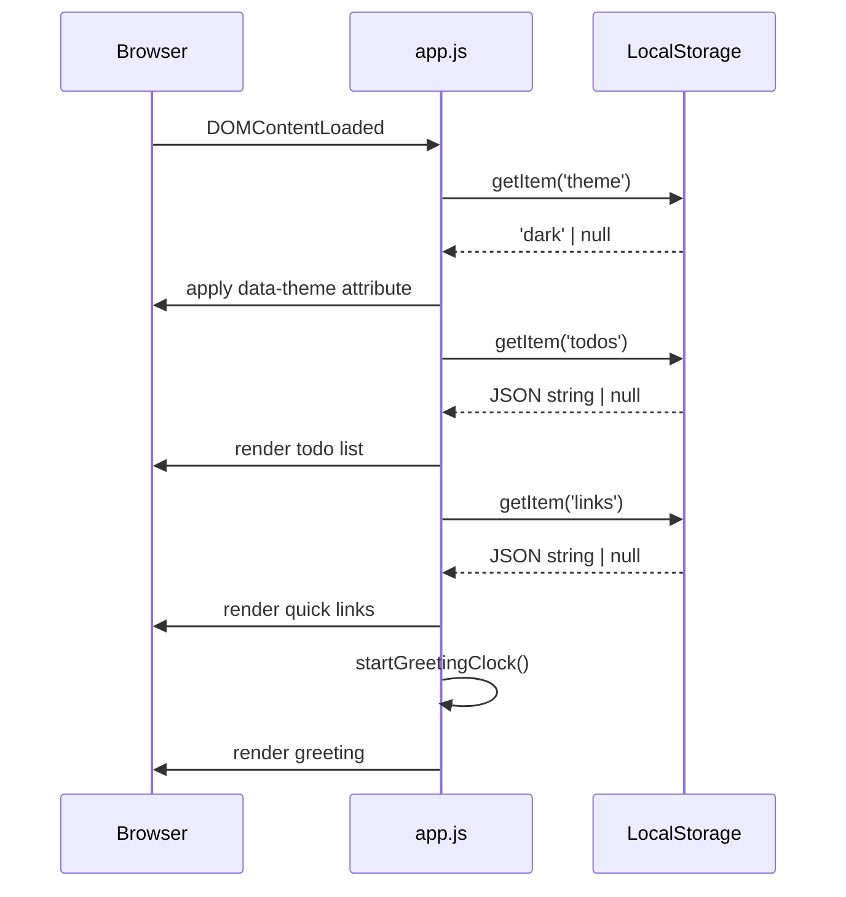
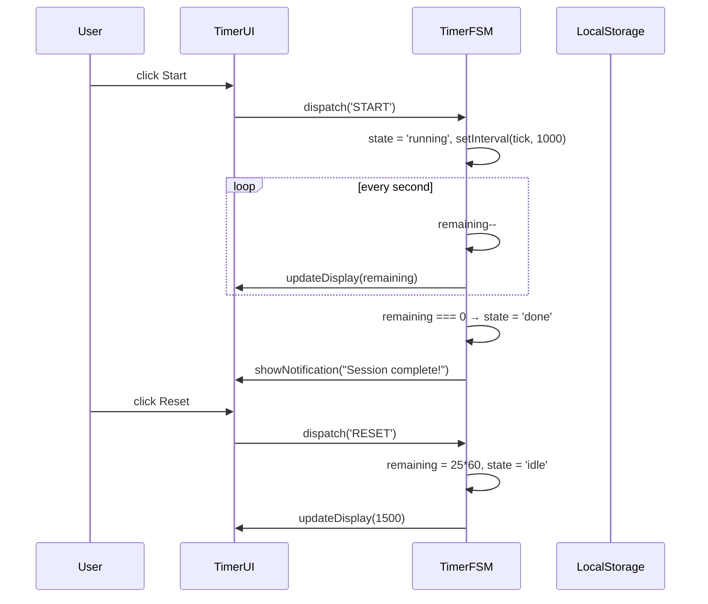
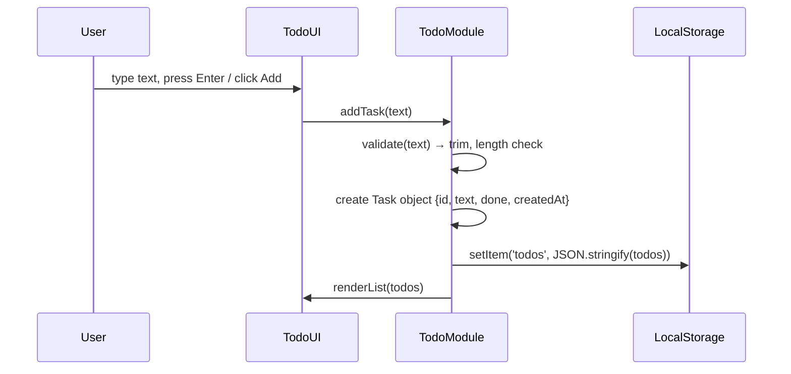

# Design Document: To-Do List Life Dashboard

## Overview

The To-Do List Life Dashboard is a self-contained, single-page web application built with HTML, CSS, and Vanilla JavaScript. It provides a personal productivity hub combining a greeting widget, a Pomodoro focus timer, a full-featured to-do list, and a quick-links launcher — all persisted via the browser's LocalStorage API.

The page loads instantly with no build step, no server, and no external dependencies. All five feature modules render inside a responsive grid layout. A light/dark mode toggle applies a CSS custom-property theme switch that persists across sessions. The design prioritises clear visual hierarchy, minimal chrome, and fast, lag-free interaction.

## Architecture

The page is structured as a single HTML file that imports one CSS file and one JS file. All logic lives in the JS module; the CSS handles layout, theming, and animation. LocalStorage is the only persistence layer.

```mermaid
graph TD
    HTML["index.html<br/>(Shell + Markup)"]
    CSS["css/style.css<br/>(Layout + Theming)"]
    JS["js/app.js<br/>(All Logic)"]

    HTML -->|link| CSS
    HTML -->|script| JS

    JS --> GreetingModule["Greeting Module<br/>updateGreeting()"]
    JS --> TimerModule["Timer Module<br/>Pomodoro FSM"]
    JS --> TodoModule["Todo Module<br/>CRUD + Sort"]
    JS --> LinksModule["Quick Links Module<br/>CRUD"]
    JS --> ThemeModule["Theme Module<br/>toggle()"]

    LocalStorage[("LocalStorage")]
    TimerModule -->|read/write timerState| LocalStorage
    TodoModule  -->|read/write todos[]| LocalStorage
    LinksModule -->|read/write links[]| LocalStorage
    ThemeModule -->|read/write theme| LocalStorage
```

## Sequence Diagrams

### Page Load



### Pomodoro Timer Tick



### Add To-Do Task



## Components and Interfaces

### Greeting Widget

**Purpose**: Shows the current time, date, a time-of-day greeting, and the user's name.

**Interface**:

```javascript
// Public API
function startGreetingClock()      // starts 1-second interval
function stopGreetingClock()       // clears interval
function setUserName(name)         // saves name to LocalStorage, re-renders
function getUserName()             // returns string from LocalStorage or 'Friend'
```

**Responsibilities**:

- Update time display every second using `setInterval`
- Format date as "Wednesday, 19 November 2026"
- Choose greeting based on hour: 05–11 → "Good morning", 12–17 → "Good afternoon", 18–21 → "Good evening", else → "Good night"
- Allow inline name editing on click

---

### Focus Timer Widget

**Purpose**: Implements a 25-minute countdown Pomodoro timer with Start, Stop, and Reset controls.

**Interface**:

```javascript
function timerDispatch(action)     // action: 'START' | 'STOP' | 'RESET'
function timerTick()               // called by setInterval every 1000 ms
function formatTime(seconds)       // returns "MM:SS" string
function updateTimerDisplay()      // writes to DOM
```

**Responsibilities**:

- Maintain a finite state machine with states: `'idle'` | `'running'` | `'paused'` | `'done'`
- Count down from 1500 seconds (25 min)
- Trigger browser Notification API (if permission granted) on completion
- Animate progress ring via SVG `stroke-dashoffset`

---

### To-Do List Widget

**Purpose**: Full CRUD management of tasks, with sort and completion toggle.

**Interface**:

```javascript
function addTask(text)             // creates and persists a new task
function deleteTask(id)            // removes task by id, persists
function toggleTask(id)            // flips done boolean, persists
function editTask(id, newText)     // updates text, persists
function sortTasks(strategy)       // strategy: 'default'|'alpha'|'done-last'
function renderTasks()             // re-renders entire list from state
function persistTasks()            // JSON.stringify → LocalStorage
function loadTasks()               // JSON.parse ← LocalStorage, returns Task[]
```

**Responsibilities**:

- Validate input (non-empty, max 200 chars)
- Support inline editing (double-click activates `contenteditable`)
- Completed tasks move to bottom when sort is `'done-last'`
- Task count badge updates on every change

---

### Quick Links Widget

**Purpose**: Displays user-defined bookmark buttons; supports adding and deleting links.

**Interface**:

```javascript
function addLink(label, url)       // validates URL, persists
function deleteLink(id)            // removes link, persists
function openLink(url)             // window.open(url, '_blank')
function renderLinks()             // re-renders link buttons
function persistLinks()            // JSON.stringify → LocalStorage
function loadLinks()               // JSON.parse ← LocalStorage, returns Link[]
```

**Responsibilities**:

- Validate URL with `new URL(url)` constructor (throws on invalid)
- Ensure HTTPS or HTTP scheme only
- Render each link as a `<button>` to avoid anchor styling conflicts

---

### Theme Module

**Purpose**: Toggles light/dark mode by switching a `data-theme` attribute on `<html>`.

**Interface**:

```javascript
function toggleTheme()             // flips between 'light' and 'dark'
function applyTheme(theme)         // sets data-theme, persists
function getTheme()                // returns 'light' | 'dark' from LocalStorage or OS preference
```

**Responsibilities**:

- Respect `prefers-color-scheme` media query as default
- Persist user override in LocalStorage under key `'theme'`
- Animate toggle icon (sun ↔ moon) via CSS transition

## Data Models

### Task

```javascript
/**
 * @typedef {Object} Task
 * @property {string}  id         - UUID v4 (crypto.randomUUID())
 * @property {string}  text       - Task description (1–200 chars)
 * @property {boolean} done       - Completion flag
 * @property {number}  createdAt  - Unix timestamp (Date.now())
 * @property {number|null} doneAt - Unix timestamp when completed, else null
 */
const Task = {
  id: crypto.randomUUID(),
  text: "",
  done: false,
  createdAt: Date.now(),
  doneAt: null,
};
```

**Validation Rules**:

- `text` must not be empty after trimming
- `text` length must not exceed 200 characters
- `id` must be unique across all tasks
- `done` toggle sets `doneAt` to `Date.now()`, clears it on un-toggle

---

### Link

```javascript
/**
 * @typedef {Object} Link
 * @property {string} id    - UUID v4
 * @property {string} label - Display label (1–50 chars)
 * @property {string} url   - Fully qualified URL (http or https)
 */
const Link = {
  id: crypto.randomUUID(),
  label: "",
  url: "",
};
```

**Validation Rules**:

- `label` must not be empty; max 50 characters
- `url` must parse without error via `new URL(url)`
- `url` protocol must be `'http:'` or `'https:'`

---

### TimerState (in-memory, not persisted)

```javascript
/**
 * @typedef {'idle'|'running'|'paused'|'done'} TimerStatus
 * @typedef {Object} TimerState
 * @property {TimerStatus} status
 * @property {number}      remaining   - Seconds left
 * @property {number}      duration    - Total seconds (default 1500)
 * @property {number|null} intervalId  - setInterval handle
 */
const timerState = {
  status: "idle",
  remaining: 1500,
  duration: 1500,
  intervalId: null,
};
```

---

### LocalStorage Schema

| Key        | Type   | Value                        |
| ---------- | ------ | ---------------------------- |
| `todos`    | string | JSON array of `Task` objects |
| `links`    | string | JSON array of `Link` objects |
| `theme`    | string | `'light'` or `'dark'`        |
| `userName` | string | Plain string, user's name    |

## Algorithmic Pseudocode

### Main Initialization Algorithm

```javascript
// ALGORITHM: initApp
// Preconditions:  DOM is fully loaded (DOMContentLoaded fired)
// Postconditions: All widgets rendered, event listeners attached, clock running

function initApp() {
  const theme = getTheme();
  applyTheme(theme); // set data-theme before paint

  const todos = loadTasks(); // [] if key absent or parse fails
  renderTasks(todos);

  const links = loadLinks(); // [] if key absent or parse fails
  renderLinks(links);

  attachEventListeners(); // single delegation pass

  startGreetingClock(); // setInterval 1 s
  updateTimerDisplay(); // paint idle 25:00
}

document.addEventListener("DOMContentLoaded", initApp);
```

---

### Pomodoro Timer Finite State Machine

```javascript
// ALGORITHM: timerDispatch
// Preconditions:  timerState is initialised
// Postconditions: state transitions are consistent; at most one intervalId active

// State transition table:
// idle    + START  → running  (start interval)
// running + STOP   → paused   (clear interval)
// running + RESET  → idle     (clear interval, remaining = duration)
// paused  + START  → running  (restart interval)
// paused  + RESET  → idle     (remaining = duration)
// done    + RESET  → idle     (remaining = duration)

function timerDispatch(action) {
  switch (timerState.status) {
    case "idle":
      if (action === "START") {
        timerState.status = "running";
        timerState.intervalId = setInterval(timerTick, 1000);
      }
      break;

    case "running":
      if (action === "STOP") {
        clearInterval(timerState.intervalId);
        timerState.intervalId = null;
        timerState.status = "paused";
      }
      if (action === "RESET") {
        clearInterval(timerState.intervalId);
        timerState.intervalId = null;
        timerState.remaining = timerState.duration;
        timerState.status = "idle";
      }
      break;

    case "paused":
      if (action === "START") {
        timerState.status = "running";
        timerState.intervalId = setInterval(timerTick, 1000);
      }
      if (action === "RESET") {
        timerState.remaining = timerState.duration;
        timerState.status = "idle";
      }
      break;

    case "done":
      if (action === "RESET") {
        timerState.remaining = timerState.duration;
        timerState.status = "idle";
      }
      break;
  }
  updateTimerDisplay();
}

// ALGORITHM: timerTick
// Loop invariant: timerState.remaining >= 0 at start of every tick
function timerTick() {
  // ASSERT timerState.status === 'running'
  timerState.remaining -= 1;
  updateTimerDisplay();

  if (timerState.remaining <= 0) {
    clearInterval(timerState.intervalId);
    timerState.intervalId = null;
    timerState.status = "done";
    updateTimerDisplay();
    notifySessionComplete();
  }
  // ASSERT timerState.remaining >= 0
}
```

---

### Task CRUD Algorithms

```javascript
// ALGORITHM: addTask
// Preconditions:  text is a string
// Postconditions: If valid, tasks[] has one more element; LocalStorage updated

function addTask(text) {
  const trimmed = text.trim();

  if (trimmed.length === 0 || trimmed.length > 200) {
    showError("Task must be 1–200 characters.");
    return;
  }

  const task = {
    id: crypto.randomUUID(),
    text: trimmed,
    done: false,
    createdAt: Date.now(),
    doneAt: null,
  };

  tasks.push(task);
  persistTasks();
  renderTasks();
}

// ALGORITHM: toggleTask
// Preconditions:  id exists in tasks[]
// Postconditions: task.done flipped; doneAt set or cleared; LocalStorage updated

function toggleTask(id) {
  const task = tasks.find((t) => t.id === id);
  if (!task) return; // guard: id not found

  task.done = !task.done;
  task.doneAt = task.done ? Date.now() : null;

  persistTasks();
  renderTasks();
}

// ALGORITHM: editTask
// Preconditions:  id exists in tasks[], newText is a string
// Postconditions: task.text updated if valid; LocalStorage updated

function editTask(id, newText) {
  const trimmed = newText.trim();
  if (trimmed.length === 0 || trimmed.length > 200) return;

  const task = tasks.find((t) => t.id === id);
  if (!task) return;

  task.text = trimmed;
  persistTasks();
  renderTasks();
}

// ALGORITHM: sortTasks
// Preconditions:  strategy ∈ {'default', 'alpha', 'done-last'}
// Postconditions: tasks[] is sorted in-place; renderTasks() called

function sortTasks(strategy) {
  if (strategy === "alpha") {
    tasks.sort((a, b) => a.text.localeCompare(b.text));
  } else if (strategy === "done-last") {
    tasks.sort((a, b) => Number(a.done) - Number(b.done));
  } else {
    // 'default': restore createdAt order
    tasks.sort((a, b) => a.createdAt - b.createdAt);
  }
  renderTasks();
}
```

---

### URL Validation Algorithm

```javascript
// ALGORITHM: validateURL
// Preconditions:  raw is any string
// Postconditions: returns { valid: boolean, normalised: string | null }

function validateURL(raw) {
  let parsed;
  try {
    // Prepend https:// if no scheme provided
    parsed = new URL(raw.includes("://") ? raw : "https://" + raw);
  } catch {
    return { valid: false, normalised: null };
  }

  if (parsed.protocol !== "http:" && parsed.protocol !== "https:") {
    return { valid: false, normalised: null };
  }

  return { valid: true, normalised: parsed.href };
}
```

---

### Theme Detection Algorithm

```javascript
// ALGORITHM: getTheme
// Preconditions:  none
// Postconditions: returns 'light' | 'dark'; preference order: LocalStorage > OS

function getTheme() {
  const stored = localStorage.getItem("theme");
  if (stored === "light" || stored === "dark") return stored;

  // Fall back to OS preference
  return window.matchMedia("(prefers-color-scheme: dark)").matches ? "dark" : "light";
}
```

## Key Functions with Formal Specifications

### `formatTime(seconds)`

```javascript
function formatTime(seconds) // returns string "MM:SS"
```

**Preconditions:**

- `seconds` is a non-negative integer
- `seconds` ≤ 5999 (99:59 max display)

**Postconditions:**

- Returns a string matching the pattern `/^\d{2}:\d{2}$/`
- Minutes part = `Math.floor(seconds / 60)`, zero-padded to 2 digits
- Seconds part = `seconds % 60`, zero-padded to 2 digits

---

### `persistTasks()`

```javascript
function persistTasks() // void
```

**Preconditions:**

- `tasks` is a valid `Task[]` array

**Postconditions:**

- `localStorage.getItem('todos')` equals `JSON.stringify(tasks)`
- No mutation of the `tasks` array

---

### `loadTasks()`

```javascript
function loadTasks() // returns Task[]
```

**Preconditions:** none

**Postconditions:**

- Returns an array (never `null` or `undefined`)
- If LocalStorage key `'todos'` is absent or contains invalid JSON, returns `[]`
- Each returned element conforms to the `Task` typedef

---

### `renderTasks()`

```javascript
function renderTasks() // void
```

**Preconditions:**

- `tasks` array is in scope and contains valid `Task` objects

**Postconditions:**

- DOM task list reflects current `tasks` array exactly
- Each task element carries a `data-id` attribute equal to `task.id`
- Completed tasks have class `done` applied
- Task count badge displays `tasks.filter(t => !t.done).length` pending tasks

---

### `addLink(label, url)`

```javascript
function addLink(label, url) // void
```

**Preconditions:**

- `label` is a string
- `url` is a string

**Postconditions:**

- If `label.trim()` is empty or `> 50` chars: shows validation error, no mutation
- If URL fails `validateURL()`: shows validation error, no mutation
- Otherwise: `links[]` gains one element, LocalStorage updated, UI re-rendered

## Example Usage

```javascript
// --- Greeting ---
setUserName("Irham");
// Renders: "Good evening, Irham 👋" with current time

// --- Timer ---
timerDispatch("START");
// Timer counts 25:00 → 00:00, then notifies

timerDispatch("STOP");
// Timer pauses at current remaining

timerDispatch("RESET");
// Timer resets to 25:00

// --- Tasks ---
addTask("Finish the dashboard design");
addTask("Review pull requests");
toggleTask(tasks[0].id); // marks first task done
editTask(tasks[1].id, "Review all PRs before 5pm");
sortTasks("done-last"); // incomplete tasks float to top
deleteTask(tasks[0].id);

// --- Links ---
addLink("GitHub", "https://github.com");
addLink("Email", "mail.google.com"); // https:// prepended automatically
openLink("https://github.com"); // opens in new tab

// --- Theme ---
toggleTheme(); // switches light → dark or dark → light
applyTheme("dark");
```

## Correctness Properties

### Property 1: formatTime output format

For every integer `n` in `[0, 5999]`, `formatTime(n)` returns a string matching `/^\d{2}:\d{2}$/` and encodes `n` uniquely (bijective within range).

**Validates: Requirements 2.1**

```javascript
// ∀ n ∈ [0, 5999]: formatTime(n).match(/^\d{2}:\d{2}$/) !== null
// ∀ n1, n2 ∈ [0, 5999]: n1 !== n2 → formatTime(n1) !== formatTime(n2)
```

### Property 2: Persistence round-trip

Serialising then deserialising the task array produces a deep-equal result.

**Validates: Requirements 3.6**

```javascript
// ∀ tasks[]: deepEquals(loadTasks(after: persistTasks(tasks)), tasks) === true
```

### Property 3: Toggle idempotence

Toggling a task twice returns it to its original `done` state.

**Validates: Requirements 3.2**

```javascript
// ∀ task ∈ tasks:
//   let original = task.done
//   toggleTask(task.id); toggleTask(task.id)
//   task.done === original
```

### Property 4: Timer remaining non-negative

The countdown never decrements below zero.

**Validates: Requirements 2.1**

```javascript
// ∀ tick while timerState.status === 'running': timerState.remaining >= 0
```

### Property 5: Task ID uniqueness

No two tasks in the array share the same `id`.

**Validates: Requirements 3.1**

```javascript
// ∀ task1, task2 ∈ tasks: task1 !== task2 → task1.id !== task2.id
```

### Property 6: Sort correctness — done-last

After `sortTasks('done-last')`, no incomplete task appears after a completed task.

**Validates: Requirements 3.5**

```javascript
// ∀ i < j in sorted tasks: !(tasks[i].done === true && tasks[j].done === false)
```

### Property 7: URL scheme safety

`validateURL` rejects any scheme other than `http:` or `https:`.

**Validates: Requirements 4.2, 8.1**

```javascript
// validateURL('ftp://example.com').valid   === false
// validateURL('javascript:alert(1)').valid === false
// validateURL('data:text/html,...').valid   === false
// validateURL('https://github.com').valid  === true
```

## Error Handling

### Scenario 1: LocalStorage unavailable or full

**Condition**: `localStorage.setItem()` throws `QuotaExceededError` or `SecurityError`

**Response**: Catch the error in `persistTasks()` / `persistLinks()`, show a dismissible toast: "Could not save — storage unavailable."

**Recovery**: Data remains in memory for the session; user is informed. No crash.

---

### Scenario 2: Corrupt LocalStorage JSON

**Condition**: `JSON.parse(localStorage.getItem('todos'))` throws

**Response**: `loadTasks()` catches the error, returns `[]`, logs a warning to console

**Recovery**: Dashboard renders empty; user starts fresh without data loss from a parse error

---

### Scenario 3: Invalid task input

**Condition**: User submits empty string or string exceeding 200 characters

**Response**: Input field gains `invalid` CSS class; inline error message shown below input

**Recovery**: User corrects input; error clears on next valid keystroke

---

### Scenario 4: Notification permission denied

**Condition**: `Notification.permission === 'denied'`

**Response**: Skip `new Notification()` call; flash the timer card border instead

**Recovery**: Visual-only fallback; no console error

---

### Scenario 5: Invalid URL for quick link

**Condition**: `validateURL(raw)` returns `{ valid: false }`

**Response**: URL input gains `invalid` class; inline message "Please enter a valid URL"

**Recovery**: User corrects URL; validation re-runs on blur

## Testing Strategy

### Unit Testing Approach

Each pure function can be tested in isolation in the browser console or a simple HTML test harness (no test runner required):

- `formatTime(0)` → `"00:00"`, `formatTime(1500)` → `"25:00"`, `formatTime(90)` → `"01:30"`
- `validateURL('github.com')` → `{ valid: true, normalised: 'https://github.com/' }`
- `validateURL('javascript:void(0)')` → `{ valid: false, normalised: null }`
- `getTheme()` returns `'light'` or `'dark'` without throwing

### Property-Based Testing Approach

No test framework is required per the spec. Manual boundary checks cover the key properties:

- Confirm `formatTime` handles edge values: `0`, `1499`, `1500`
- Confirm `loadTasks()` returns `[]` when LocalStorage is manually set to `"not-json"`
- Confirm timer never decrements below 0 by running to completion in a headless tab

### Integration Testing Approach

Manual smoke test checklist:

1. Load page → all widgets render, theme matches OS preference
2. Add 3 tasks → refresh page → tasks persist
3. Toggle a task done → reload → state preserved
4. Run timer to 0 → notification appears (or border flashes if denied)
5. Add a link → click it → new tab opens at correct URL
6. Toggle theme → reload → theme persists

## Performance Considerations

- **No external resources**: zero network requests after initial page load
- **DOM updates**: each `renderTasks()` call rebuilds only the task list (`innerHTML` replacement on the container), not the entire page
- **setInterval frequency**: 1 second is the minimum for human-readable timers; no sub-second intervals
- **LocalStorage reads**: performed once at startup; subsequent reads are in-memory only
- **CSS transitions**: kept under 300 ms to avoid perceived lag; `will-change: transform` applied only to the toggle icon

## Security Considerations

- **XSS prevention**: all user-supplied text (`task.text`, `link.label`) inserted via `textContent` or `element.dataset`, never `innerHTML`
- **URL scheme enforcement**: `validateURL()` rejects `javascript:`, `data:`, and `vbscript:` schemes before any `window.open()` call
- **No `eval` or `Function` constructor** anywhere in the codebase
- **CSP-ready**: the page carries no inline event handlers; all listeners are attached via `addEventListener` so a strict CSP can be added later

## Dependencies

**Runtime**: None. The page has zero external dependencies.

**Browser APIs used**:

- `localStorage` (Web Storage API)
- `crypto.randomUUID()` (Web Crypto API — available in all modern browsers)
- `setInterval` / `clearInterval` (Timers API)
- `Notification` API (optional; graceful fallback when unavailable)
- `window.matchMedia` (CSS Media Queries API)
- `window.open` (Window API)

**Minimum browser versions** (all features used are baseline-available):

- Chrome 92+, Firefox 90+, Safari 15.4+, Edge 92+
